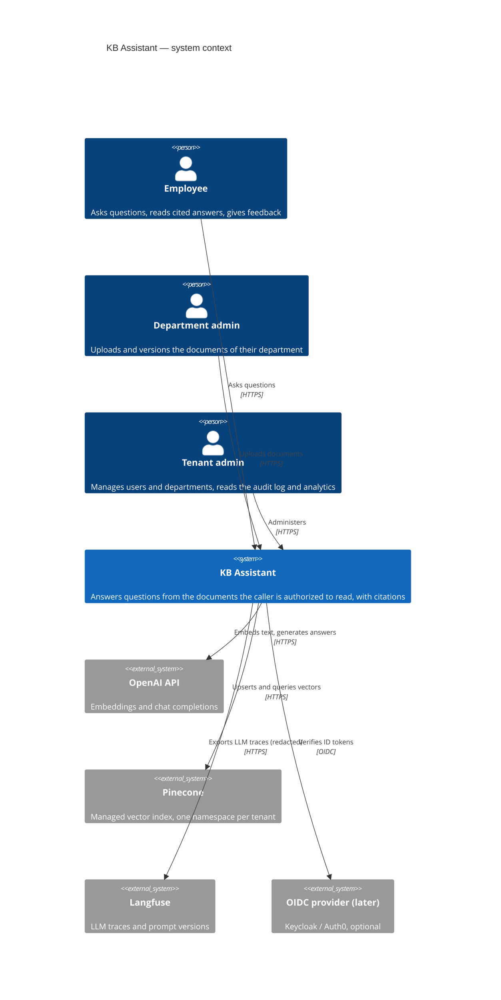
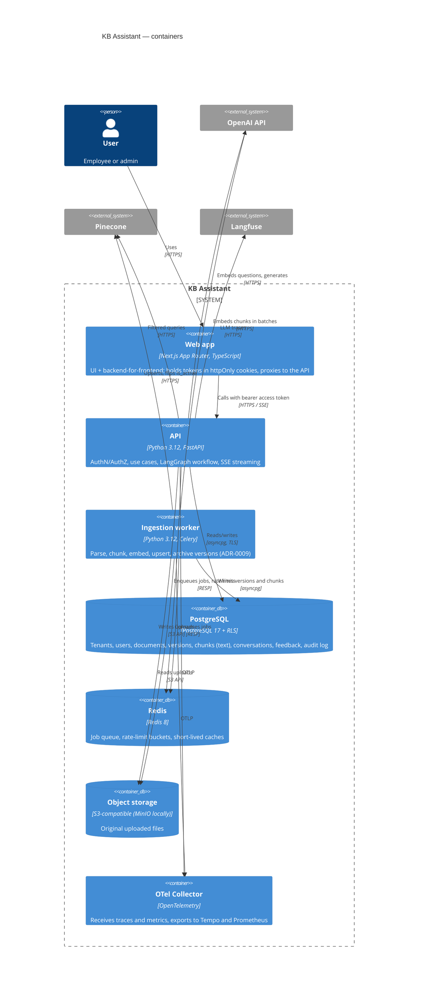
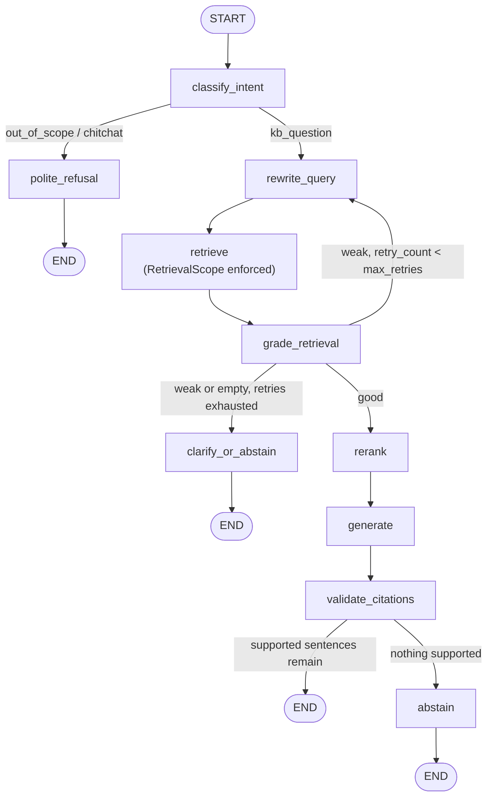
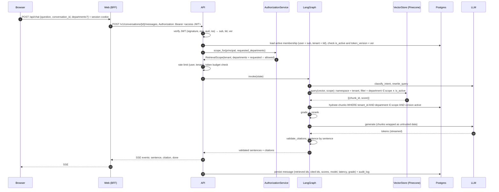
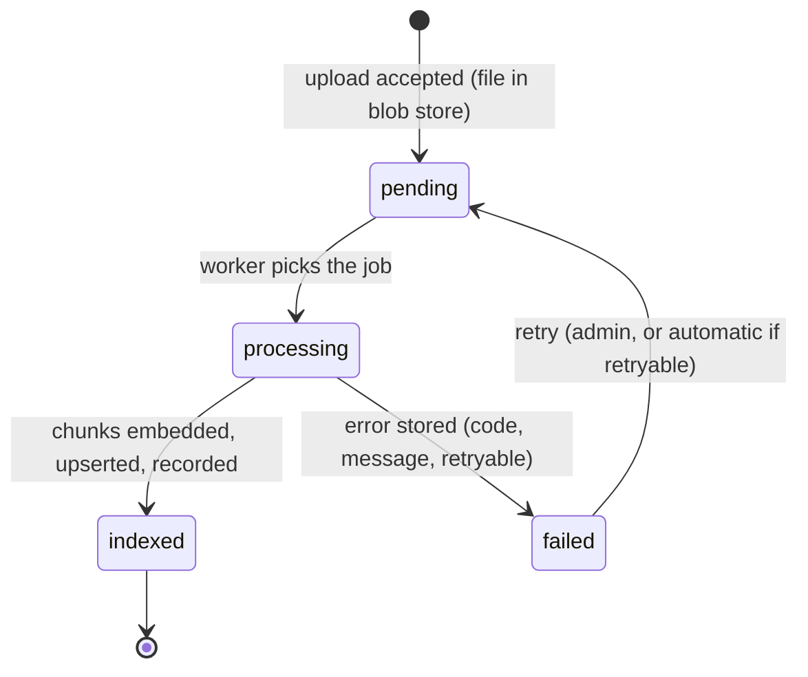
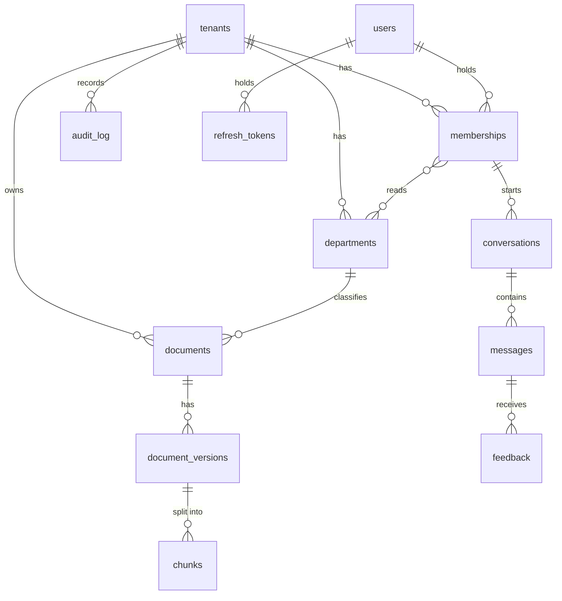
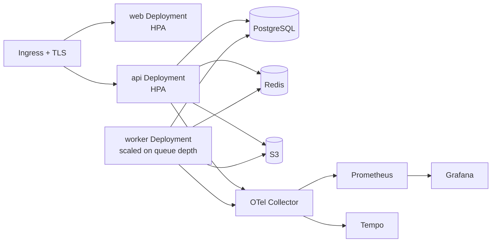

# Architecture

> Status: **Phase 0 — proposed, awaiting review.**
> Decisions referenced as `ADR-NNNN` live in [`docs/adr/`](adr/README.md).
> The threat model lives in [`docs/SECURITY.md`](SECURITY.md).

## 1. Problem

Employees lose time looking for answers that already exist somewhere in their
company: an onboarding page, a runbook, an HR policy, a product spec. A generic
chatbot cannot help, because the answers live in private documents, and a naive
"chat with your files" assistant is dangerous, because it would happily answer an
engineer's question with a paragraph from a confidential HR document.

KB Assistant answers questions **only** from the documents the person asking is
allowed to read, cites every claim, and says "I don't know" when the evidence is
not there.

### Quality goals (in priority order)

| # | Goal | What it means concretely | How it is proven |
|---|------|--------------------------|------------------|
| 1 | **Isolation** | A chunk the caller may not read never reaches the LLM prompt. | Security tests assert on the arguments of the vector-store call and on the hydrated chunks, not on the answer text. |
| 2 | **Groundedness** | Every sentence of an answer is backed by a retrieved, cited chunk, or the system abstains. | Faithfulness, citation precision and abstention correctness in the eval gate (Phase 4). |
| 3 | **Traceability** | Any answer can be explained after the fact: which chunks, which scores, which models, how long. | `messages` row + OpenTelemetry trace + LLM trace share one `request_id`. |
| 4 | **Replaceability** | The LLM, the embedding model and the vector store can be swapped without touching use cases. | Contract tests run the same suite against the Pinecone and pgvector adapters. |
| 5 | **Operability** | Failures are visible, bounded and recoverable. | Timeouts, retries, circuit breaker, health/readiness probes, RED metrics, dashboards. |

### Explicit non-goals for v1

- Connectors to Slack, Notion, Google Drive, Confluence. Each connector needs
  OAuth **and** a faithful copy of the source system's permissions; doing that
  badly would break goal 1. v1 ingests uploaded PDF, DOCX, Markdown and HTML
  through a `DocumentSource` port that connectors will implement later
  ([ADR-0013](adr/0013-upload-first-connectors-behind-a-source-port.md)).
- A tenant-switcher UI. The **data model** supports a user in several tenants
  from day one (§6.1); the v1 UI shows only the active tenant.
- Per-document ACLs finer than "department". The model leaves room for it (§6.3).
- Agents with tools. The LLM reads and writes text; it cannot call anything.
  This is a deliberate security property (see [SECURITY.md](SECURITY.md), T2).

## 2. System context (C4 level 1)



## 3. Containers (C4 level 2)



Notes on the container choices:

- **Object storage** is an addition to the spec. The worker must not receive file
  bytes through Redis (size, retention, and a queue is not a file store), and the
  original file is needed to re-ingest with a new chunker or embedding model.
  MinIO in docker-compose, any S3 in production.
- **The web app is a backend-for-frontend**, not just static pages: the browser
  never sees a JWT ([ADR-0008](adr/0008-nextjs-bff-token-handling.md)).
- **Local and CI profiles** replace Pinecone with pgvector and OpenAI with
  deterministic fakes behind the same ports
  ([ADR-0002](adr/0002-vector-store-pinecone-with-pgvector-for-local.md),
  [ADR-0006](adr/0006-provider-abstraction.md)), so tests never need a paid key.

## 4. Code structure (C4 level 3, API and worker)

Hexagonal architecture ([ADR-0010](adr/0010-hexagonal-architecture-and-repository-layout.md)).
Dependencies point inward only; `domain` imports nothing from the outer rings.

```mermaid
flowchart LR
    subgraph api_ring["api/ (FastAPI)"]
        routers["routers + schemas<br/>RFC 7807 errors"]
        deps["dependencies:<br/>current_principal"]
    end
    subgraph app_ring["application/"]
        usecases["use cases<br/>AskQuestion, UploadDocument, …"]
        graph["LangGraph workflow<br/>nodes + routing"]
        authz["AuthorizationService<br/>→ RetrievalScope"]
    end
    subgraph domain_ring["domain/"]
        entities["entities + value objects<br/>Principal, RetrievalScope, Chunk, Citation"]
        ports["ports (Protocols)<br/>VectorStore, Embedder, ChatModel, Reranker,<br/>repositories, Clock, BlobStore"]
        errors["domain errors"]
    end
    subgraph infra_ring["infrastructure/"]
        pineconeA["PineconeVectorStore"]
        pgvectorA["PgVectorStore"]
        openaiA["OpenAIEmbedder / OpenAIChatModel"]
        fakes["Fake* (tests, offline demo)"]
        sqla["SQLAlchemy repositories"]
    end

    routers --> usecases
    deps --> authz
    usecases --> graph
    usecases --> ports
    graph --> ports
    authz --> entities
    infra_ring -. implements .-> ports
```

## 5. The question-answering workflow

### 5.1 Graph

Implemented with LangGraph, typed state, explicit conditional edges
([ADR-0007](adr/0007-langgraph-for-the-question-workflow.md)).



One deviation from the spec diagram: `validate_citations` has an outgoing edge to
`abstain`. If the model cites a chunk that was not retrieved, or writes a
sentence with no citation, we do not ship a partly ungrounded answer. We drop the
unsupported sentences; if nothing supported remains, we abstain. The number of
dropped sentences is recorded, because a rising rate is an early signal of a
prompt or model regression.

An empty retrieval (`empty`) skips the retry loop when the scope itself is
empty (the user has no readable department): rewriting the query cannot help.

### 5.2 State

```python
class GraphState(TypedDict):
    # identity: set once by the use case from the authenticated Principal, never from the request body
    request_id: str
    tenant_id: str
    user_id: str
    scope: RetrievalScope            # replaces the spec's allowed_departments: list[str] (see §6.2)

    # conversation
    question: str
    conversation_summary: str | None

    # routing
    intent: Literal["kb_question", "out_of_scope", "chitchat"]
    rewritten_query: str
    retry_count: int

    # retrieval
    retrieved_chunks: list[RetrievedChunk]       # hydrated from Postgres, authorized twice
    retrieval_grade: Literal["good", "weak", "empty"]
    reranked_chunks: list[RetrievedChunk]

    # outcome
    answer: str | None
    citations: list[Citation]
    needs_clarification: bool
    abstained: bool
    abstain_reason: AbstainReason | None

    # telemetry, written by every node
    node_timings_ms: dict[str, float]
    token_usage: TokenUsage
```

`scope` is a value object instead of a raw `list[str]`, so a node cannot pass a
client-supplied list to the vector store by accident: the vector-store port only
accepts a `RetrievalScope`, and the only code that builds one is the
`AuthorizationService` (§6.2). The type checker enforces what a code review
would otherwise have to catch.

### 5.3 Sequence of one request



### 5.4 Grounding and streaming

- Chunks are shown to the model under **short local aliases** (`S1…Sn`), not
  database IDs. The model can only cite an alias that exists in this prompt;
  `validate_citations` maps aliases back to chunk IDs. A forged or hallucinated
  ID cannot point outside the retrieved set, because there is nothing to map it to.
- Streaming is **sentence-granular**: tokens are buffered until a sentence ends,
  its citation markers are validated, and only then is it sent. The client never
  displays text that a later check would retract.
- **No fake confidence percentages.** The UI shows the retrieval grade and the
  number of cited sources. A calibrated score may be added in Phase 4 only if the
  eval set shows it actually predicts correctness.

### 5.5 Thresholds

`retrieval.min_score`, `retrieval.top_k`, `retrieval.rerank_top_n` and
`graph.max_retries` live in configuration with **uncalibrated placeholder values**
until Phase 4. Cosine scores of `text-embedding-3-small` fall in a narrow band,
so a threshold borrowed from a blog post would be meaningless. The calibration
method (sweep over the eval set, pick the threshold that maximizes abstention
correctness subject to a hit@k floor) will be documented in `docs/EVALUATION.md`.
Every message row stores the threshold values that were in effect, so a change
shows up in the data.

## 6. Multi-tenancy and authorization

### 6.1 Identity

**Identity is separate from membership**
([ADR-0012](adr/0012-identity-separate-from-tenant-membership.md)):

- A **tenant** is a company. A **user** is a person with credentials, global to
  the platform. A **membership** links a user to a tenant and carries the role
  and the departments *in that tenant*. A consultant or an employee of two
  subsidiaries has two memberships with different roles.
- Every access token is **scoped to one tenant**: it carries `sub` (user id),
  `tid` (active tenant) and `ver` (the user's token version). Switching tenant
  means obtaining a new token pair for the other membership, so no request can
  ever span two tenants.
- **Role and departments are never read from the token.** The API loads the
  active membership `(sub, tid)` on every request (unique-index lookup, cached
  for a few seconds in-process), so a demotion, a department change or a
  removal from the tenant takes effect at once, not when the token expires
  ([ADR-0005](adr/0005-authentication-and-authorization-model.md)).
- No active membership for `(sub, tid)`, an inactive user, or a stale `ver` is a
  401 and an audit event.

### 6.2 Read access

| Role | Can read (chat) | Can manage documents | Can administer |
|------|-----------------|----------------------|----------------|
| `employee` | own departments | — | — |
| `dept_admin` | own departments | own departments | analytics of own departments |
| `tenant_admin` | all departments of the tenant | all departments | users, departments, audit log, analytics |

The only constructor of `RetrievalScope` is
`AuthorizationService.scope_for(principal, requested: set[DepartmentId] | None)`.
It returns `allowed ∩ requested`, or `allowed` when nothing is requested. A
department filter in the UI can therefore **narrow** a search, never widen it.
Requesting a department the user cannot read is a 403, not a silent fallback to
a wider scope.

### 6.3 Enforcement points (defense in depth)

A chunk passes **three independent checks** before it can enter a prompt:

1. **Vector store query.** Pinecone namespace = tenant id; metadata filter
   `department ∈ scope.departments ∧ is_active = true`
   ([ADR-0003](adr/0003-tenant-isolation-namespaces-plus-metadata-filters.md)).
2. **Hydration from Postgres.** Chunk text lives in Postgres, not in vector
   metadata. Vector hits are hydrated by a query that repeats the tenant,
   department and active-version predicates. A hit that fails hydration is
   dropped and counted (`authz_hydration_rejections_total`); a non-zero value
   alerts, because it means check 1 is broken.
3. **Postgres row-level security.** Every tenant-scoped table has an RLS policy
   `tenant_id = current_setting('app.tenant_id')::uuid`. The API connects with a
   role that does not own the tables and sets `app.tenant_id` per transaction.
   A forgotten `WHERE tenant_id = …` returns nothing instead of another tenant's
   rows.
   The global `users` table holds no tenant data; tenant-side code reaches a
   user only through `memberships`, which is RLS-protected.

Per-document ACLs, if ever needed, add an `acl_groups` predicate to the same
three checks; nothing above them changes.

## 7. Ingestion



1. **Upload** (`POST /v1/documents`, `POST /v1/documents/{id}/versions`): size
   limit, MIME type checked from magic bytes rather than the extension, SHA-256
   computed while streaming to the blob store.
2. **Idempotency.** If the checksum equals the document's active version, the
   request is a no-op that returns the existing version. A job processed twice
   is harmless: vector IDs are deterministic (`{version_id}:{chunk_index}`) and
   chunk rows have a unique key on `(document_version_id, chunk_index)`.
3. **Parse → clean → chunk**: recursive, token-aware, with overlap, keeping page
   numbers and the heading path ([ADR-0004](adr/0004-chunking-strategy.md)).
4. **Embed** in batches, with retry and exponential backoff on 429 and 5xx.
5. **Upsert** to the tenant namespace, write chunk rows, then switch
   `documents.current_version_id` in one transaction. Only after that commit
   does the worker flip the old version's vectors to `is_active=false`. Between
   the two steps, hydration (check 2) already filters the old version out, so a
   reader never sees two versions at once.
6. **Archive, never silently delete.** Old versions stay available for audit.
   Physical deletion is a separate, logged retention job (tenant offboarding, a
   legal erasure request) that deletes vectors by ID and rows by version.

## 8. Data model



Changes against the spec's data model, each in service of a quality goal:

| Change | Why |
|--------|-----|
| `users(id, email, hashed_password, is_active, token_version)` without `tenant_id`, `role` or `departments`; `memberships(id, user_id, tenant_id, role, is_active)` with a unique key on `(user_id, tenant_id)` | Identity separate from membership ([ADR-0012](adr/0012-identity-separate-from-tenant-membership.md)): supports a person in several tenants and per-tenant SSO without a migration of the users table. |
| `departments(id, tenant_id, slug, name)` and a `membership_departments` join table instead of `users.departments[]` | Referential integrity: a typo in a department string would otherwise grant nothing, or create a department nobody can see. A composite foreign key guarantees the department and the membership belong to the same tenant. |
| `documents.source_type` (`upload` in v1) and `documents.external_id` | Connectors plug in later without a schema change ([ADR-0013](adr/0013-upload-first-connectors-behind-a-source-port.md)). |
| `chunks.text` stored in Postgres; Pinecone metadata holds only IDs and filter fields | Enables check 2 (hydration), keeps one less copy of document text at a third party, and avoids the 40 KB metadata limit. |
| `refresh_tokens(id, user_id, family_id, token_hash, expires_at, revoked_at, replaced_by)` | Rotation with reuse detection ([ADR-0005](adr/0005-authentication-and-authorization-model.md)). |
| `users.token_version` | Bumping it revokes every outstanding access token of that user. |
| `documents.error_code`, `documents.error_retryable` | A failed ingestion tells the admin what to do, not just that it failed. |
| `messages.thresholds` (JSONB), `messages.prompt_version`, `messages.token_usage` | Traceability: every answer can be reproduced in context. |
| `tenant_id` on every tenant-scoped table, including `messages` and `feedback` | Required by RLS; join-based tenant checks are too easy to forget. |

Primary keys are UUIDv7: time-ordered for index locality. They expose a
creation timestamp but not volumes (unlike sequential integers), which is
acceptable here. Authorization never relies on IDs being hard to guess.

## 9. API surface (v1, summary)

| Method & path | Role | Notes |
|---------------|------|-------|
| `POST /v1/auth/login` · `/refresh` · `/logout` | public / authenticated | Called by the BFF only |
| `POST /v1/auth/switch-tenant` | authenticated | Issues a token pair for another active membership of the same user |
| `POST /v1/memberships` (invite) | `tenant_admin` | No open self-registration into a tenant |
| `GET /v1/me` | any | Active tenant, role, departments, list of other memberships |
| `POST /v1/conversations` · `GET /v1/conversations` | any | Own conversations only |
| `POST /v1/conversations/{id}/messages` | any | SSE stream |
| `POST /v1/messages/{id}/feedback` | any | Own messages only |
| `POST /v1/documents` · `POST /v1/documents/{id}/versions` · `GET /v1/documents` | `dept_admin`+ | Scoped to managed departments |
| `GET /v1/admin/analytics/*` | `tenant_admin`, `dept_admin` (own departments) | |
| `GET /v1/admin/audit-log` (+ CSV export) | `tenant_admin` | |
| `GET /healthz` · `GET /readyz` · `GET /metrics` | infrastructure | `/metrics` is not exposed through the ingress |

Conventions: errors are RFC 7807 `application/problem+json`; another tenant's or
another user's resource is a **404, not a 403**, so IDs cannot be probed; list
endpoints use cursor pagination.

## 10. Cross-cutting concerns

| Concern | Approach |
|---------|----------|
| Configuration | `pydantic-settings`, one validated `Settings` tree, fails fast at startup; secrets only from the environment or K8s Secrets. |
| Logging | JSON on stdout with `request_id`, `trace_id`, `tenant_id`, `user_id` bound per request; a redaction processor masks emails, phone numbers, tokens and IBAN-like strings. Question and answer text is **not** logged: it lives in the database and the audit log, where retention applies. |
| Tracing | OpenTelemetry: API span → one span per graph node → vector store, LLM and DB spans. Langfuse receives LLM traces tagged with the same `request_id`. |
| Metrics | RED per endpoint; `retrieval_grade_total{grade}`, `abstentions_total{reason}`, `llm_tokens_total{tenant,model,kind}`, `authz_hydration_rejections_total`, ingestion duration and failures. |
| Resilience | Timeouts on every outbound call; `tenacity` retries with jitter on idempotent calls; a circuit breaker on the LLM turns an outage into a fast "temporarily unavailable" answer. |
| Rate limiting and cost | Redis token buckets per user and per tenant; a monthly token budget per tenant, checked before calling the LLM. |
| Retention | Conversations keep a rolling summary; raw messages expire after a configurable period per tenant; the audit log has its own, longer retention. |

## 11. Deployment view (Phase 7)



Secrets come from Kubernetes Secrets (sealed or synced by external-secrets),
never from the repository. Containers run as non-root with a read-only root
filesystem.

## 12. Trade-offs we accept

| We chose | Over | Cost we accept |
|----------|------|----------------|
| Loading role and departments from Postgres per request | Trusting JWT claims | One indexed lookup per request (cached a few seconds). |
| Text in Postgres + hydration | Text in Pinecone metadata | One extra DB round trip per question. |
| Sentence-granular streaming | Token streaming | The first visible text arrives slightly later. |
| Abstaining when no cited sentence survives validation | Shipping a best-effort answer | Some correct answers are withheld; measured by abstention correctness. |
| Pinecone in production | pgvector everywhere | A third party holds embeddings; mitigated by namespaces, no raw text in metadata, and a data processing agreement. |

## 13. Deviations from the initial specification

| Specification | This design | Where justified |
|---------------|-------------|-----------------|
| `allowed_departments: list[str]` in the graph state | `scope: RetrievalScope` value object | §5.2, [ADR-0003](adr/0003-tenant-isolation-namespaces-plus-metadata-filters.md) |
| `validate_citations → END` | `validate_citations → END` or `→ abstain` | §5.1 |
| Chunk text in vector metadata (or Postgres if too large) | Always in Postgres; metadata holds IDs and filter fields | §6.3, §8 |
| `users.departments[]` | `departments` table + join table | §8 |
| Celery **or** arq | Celery (arq is in maintenance-only mode) | [ADR-0009](adr/0009-celery-for-background-jobs.md) |
| Not specified | Object storage for original files | §3 |
| Not specified | Postgres row-level security as a third isolation check | §6.3 |
| Cross-encoder or LLM reranker | `bge-reranker-v2-m3`, same weights hosted and local | [ADR-0011](adr/0011-reranking-with-bge-reranker-v2-m3.md) |
| `users.tenant_id`, `users.role`, `users.departments[]` | `memberships` (user × tenant, role) + `membership_departments` | §6.1, [ADR-0012](adr/0012-identity-separate-from-tenant-membership.md) |
| Not specified | `DocumentSource` port, `documents.source_type` | [ADR-0013](adr/0013-upload-first-connectors-behind-a-source-port.md) |
