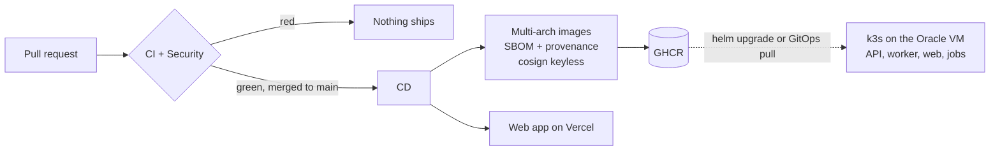

# Deployment

How code reaches production, and the one-time setup it needs. The reasoning is
in [ADR-0014](adr/0014-delivery-pipeline-and-deployment-targets.md).



## One-time setup

### GitHub repository

1. Settings → Branches: protect `main` (require a pull request, the `CI` and
   `Security` checks, signed commits, linear history).
2. Settings → Code security: enable secret scanning and push protection.
3. Settings → Actions → General: "Workflow permissions" = read repository
   contents (the workflows request more per job when they need it).

### Vercel (web app)

1. Create a Vercel project and link it once from `web/` with `npx vercel link`.
   Leave "Root Directory" empty: the workflow runs the CLI inside `web/`.
2. Create a token (Account Settings → Tokens), scoped to that team.
3. In GitHub → Settings → Environments, create `production-web` (add yourself as
   a required reviewer if you want a manual gate), then add:
   - secret `VERCEL_TOKEN`;
   - repository variables `VERCEL_ORG_ID` and `VERCEL_PROJECT_ID`
     (from `web/.vercel/project.json`, which is git-ignored).

Until `VERCEL_PROJECT_ID` exists, the deploy job is skipped, not failed.

## Verifying an image

Every image on GHCR is signed by the CD workflow, from `main`, through GitHub's
OIDC identity. Anyone can check that an image was built by this repository's
pipeline and not pushed by hand. Use cosign 3 or later: signatures are stored
in the Sigstore bundle format, which cosign 2 does not look for (it reports
"no signatures found").

```bash
cosign verify ghcr.io/malakbenhassine/kb-assistant-backend:main \
  --certificate-identity "https://github.com/MalakBenHassine/KB-Assistant/.github/workflows/cd.yml@refs/heads/main" \
  --certificate-oidc-issuer https://token.actions.githubusercontent.com
```

The SBOM and the SLSA provenance are attached to the image as attestations:

```bash
docker buildx imagetools inspect ghcr.io/malakbenhassine/kb-assistant-backend:main \
  --format '{{ json .SBOM }}'
```

## Backend hosting (Kubernetes)

The Helm chart in [`deploy/helm/kb-assistant`](../deploy/helm/kb-assistant)
deploys the API, the worker, the web app, the migration hook and the
maintenance jobs. The reasoning is in
[ADR-0021](adr/0021-observability-and-kubernetes-packaging.md); the alerts are
explained in the [runbook](RUNBOOK.md).

### What the chart expects to exist

| Dependency | Notes |
|---|---|
| PostgreSQL 17 with the `vector` extension | Two roles: an owner (migrations, jobs) and the application role, **non-owner, without `BYPASSRLS`** (`deploy/compose/postgres-init` shows the grants) |
| Redis | Broker and rate limits; TLS (`rediss://`) outside a single node |
| S3-compatible storage | One bucket for originals |
| Ingress controller and cert-manager | k3s ships Traefik; the default issuer is `letsencrypt` |
| Optional: kube-prometheus-stack | For the ServiceMonitor, alerts and the Grafana dashboard |
| Optional: an OTLP collector | Tempo, Jaeger or an OpenTelemetry Collector |

### Install

```bash
kubectl create namespace kb
kubectl label namespace kb pod-security.kubernetes.io/enforce=restricted
kubectl -n kb create secret generic kb-assistant-backend \
  --from-literal=KB_DATABASE__URL='postgresql+asyncpg://kb_app:...@db:5432/kb' \
  --from-literal=KB_DATABASE__MIGRATION_URL='postgresql+asyncpg://kb_owner:...@db:5432/kb' \
  --from-literal=KB_REDIS__URL='rediss://:...@redis:6379/0' \
  --from-literal=KB_STORAGE__ACCESS_KEY=... --from-literal=KB_STORAGE__SECRET_KEY=... \
  --from-literal=OPENAI_API_KEY=...
kubectl -n kb create secret generic kb-assistant-signing-key \
  --from-file=jwt_signing_key.pem=./jwt_signing_key.pem
helm upgrade --install kb deploy/helm/kb-assistant -n kb \
  --set ingress.host=kb.example.com \
  --set images.backend.digest=sha256:... --set images.web.digest=sha256:...
```

Pin images by digest and verify them first (above). The namespace enforces the
*restricted* Pod Security Standard; every pod of the chart complies (non-root
numeric users, read-only root filesystems, no capabilities, `RuntimeDefault`
seccomp, no service-account token).

The chart refuses, through `values.schema.json`, an unknown value, a malformed
digest, or anything that looks like a secret under `config`: secrets come from
Secrets only. `make chart` lints and validates it as CI does.

### Network

A default-deny NetworkPolicy covers every pod; the others open exactly:
ingress controller → web :3000; web → API :8000; monitoring → API :8000 and
worker :9100; API and worker → ports 5432, 6379, 443 and DNS; jobs → 5432 and
DNS. The API is never routed by the ingress, `/metrics` included.

### Upgrades

`helm upgrade` runs `alembic upgrade head` as a pre-upgrade hook with the owner
URL, then rolls the pods (`maxUnavailable: 0`). Migrations are written to be
compatible with the previous version of the code during the rollout.

### Observability

- Metrics: set `monitoring.serviceMonitor.enabled=true` (needs the Prometheus
  Operator); the same flag installs the Grafana dashboard as a ConfigMap for
  the Grafana sidecar. `monitoring.prometheusRule.enabled=true` adds the alerts.
- Traces: set `tracing.otlpEndpoint`; the standard `OTEL_*` variables tune the
  exporter.
- Retention: the `retention` CronJob deletes questions and answers older than
  `maintenance.retention.olderThanDays` and audits each deletion. The
  `audit-heads` CronJob prints every tenant's audit chain head as a JSON line:
  route those lines to write-once storage (ADR-0019).

### Target: k3s on one Oracle Cloud VM

The Always Free Ampere VM runs k3s; the images are multi-arch, so the same
digests run there. PostgreSQL with pgvector and Redis run as separate
workloads or managed services; their backups are outside this chart. Pulling
signed images and refusing unsigned ones is the GitOps controller's job
(Flux with cosign verification), configured outside this repository.
