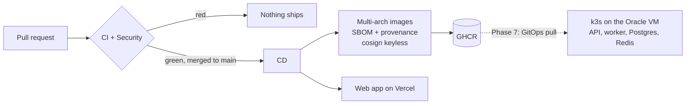

# Deployment

How code reaches production, and the one-time setup it needs. The reasoning is
in [ADR-0014](adr/0014-delivery-pipeline-and-deployment-targets.md).



## One-time setup

### GitHub repository

1. Settings → Branches: protect `main` (require a pull request, the `CI` and
   `Security` checks, signed commits, linear history).
2. Settings → Code security: enable secret scanning and push protection.
3. Settings → Actions → General: "Workflow permissions" = read repository
   contents (the workflows request more per job when they need it).

### Vercel (web app)

1. Create a Vercel project and link it once from `web/` with `npx vercel link`.
   Leave "Root Directory" empty: the workflow runs the CLI inside `web/`.
2. Create a token (Account Settings → Tokens), scoped to that team.
3. In GitHub → Settings → Environments, create `production-web` (add yourself as
   a required reviewer if you want a manual gate), then add:
   - secret `VERCEL_TOKEN`;
   - repository variables `VERCEL_ORG_ID` and `VERCEL_PROJECT_ID`
     (from `web/.vercel/project.json`, which is git-ignored).

Until `VERCEL_PROJECT_ID` exists, the deploy job is skipped, not failed.

## Verifying an image

Every image on GHCR is signed by the CD workflow, from `main`, through GitHub's
OIDC identity. Anyone can check that an image was built by this repository's
pipeline and not pushed by hand. Use cosign 3 or later: signatures are stored
in the Sigstore bundle format, which cosign 2 does not look for (it reports
"no signatures found").

```bash
cosign verify ghcr.io/malakbenhassine/kb-assistant-backend:main \
  --certificate-identity "https://github.com/MalakBenHassine/KB-Assistant/.github/workflows/cd.yml@refs/heads/main" \
  --certificate-oidc-issuer https://token.actions.githubusercontent.com
```

The SBOM and the SLSA provenance are attached to the image as attestations:

```bash
docker buildx imagetools inspect ghcr.io/malakbenhassine/kb-assistant-backend:main \
  --format '{{ json .SBOM }}'
```

## Backend hosting

Planned for Phase 7: the API, the worker, PostgreSQL and Redis as k3s workloads
on the Oracle Cloud Always Free Ampere VM, deployed by a GitOps controller that
pulls signed images and refuses unsigned ones.
